# UI веб-панелі ProStock

Документ фіксує реалізований інтерфейс, стани та дизайн-рішення. Використовується як
UI-специфікація до спринту (замінює окремі макети: усі екрани реалізовані в коді).

## Дизайн-система

| Токен | Значення | Призначення |
|---|---|---|
| `--color-primary` | `#656b46` | бренд, основні дії |
| `--color-save` | `#466b46` | збереження |
| `--color-danger` | `#811e1e` | видалення, помилки |
| `--color-bg` | `#f3f4f6` | фон сторінок |
| `--color-surface` | `#ffffff` | картки, модальні вікна |
| `--color-border` | `#dbdbdb` | межі |
| `--color-muted` | `#737373` | другорядний текст |
| `--color-success-bg` | `#d1f0d1` | успішні операції |
| `--radius-sm/md/pill` | `8/12/20px` | радіуси |
| `--font-sans` | Inter | типографіка |

Сітка сторінки: відступ `40px` на десктопі, `16px` на мобільному; контент у картках
з м'якими тінями; іконки — SVG (`lucide-react`), без емодзі.

## Екрани

### Вхід

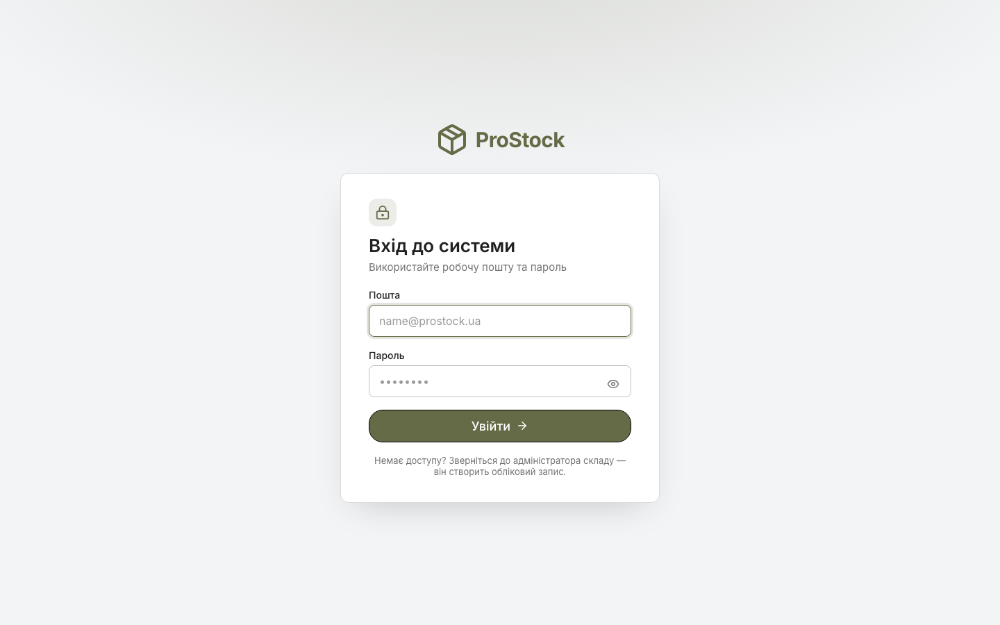

- поля «Пошта» і «Пароль» з підписами та `aria-label`;
- валідація на blur і submit: формат email, довжина пароля, Caps Lock;
- повідомлення сервера: невірні дані, заблокований акаунт, забагато спроб;
- повідомлення «Сесія завершилася» після авто-виходу;
- кнопка показу пароля з `aria-label`, фокус на першому полі.

### Головна

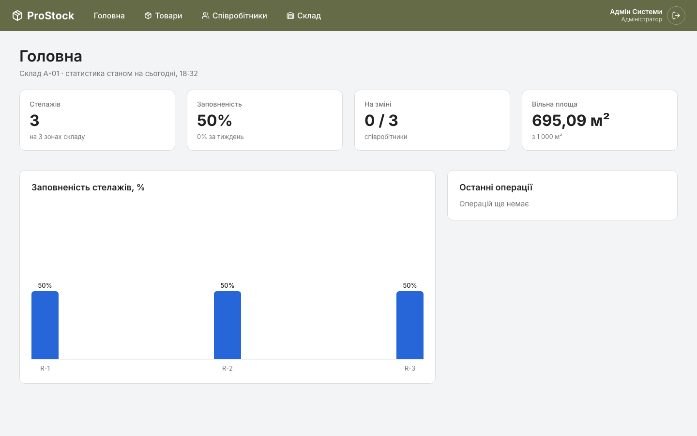

- чотири KPI-картки: стелажі, заповненість, зміна, вільна площа;
- графік заповненості стелажів і останні операції;
- дані реальні: кількість стелажів/зон, зайняті полиці, активні користувачі, вільна площа.

### Каталог товарів

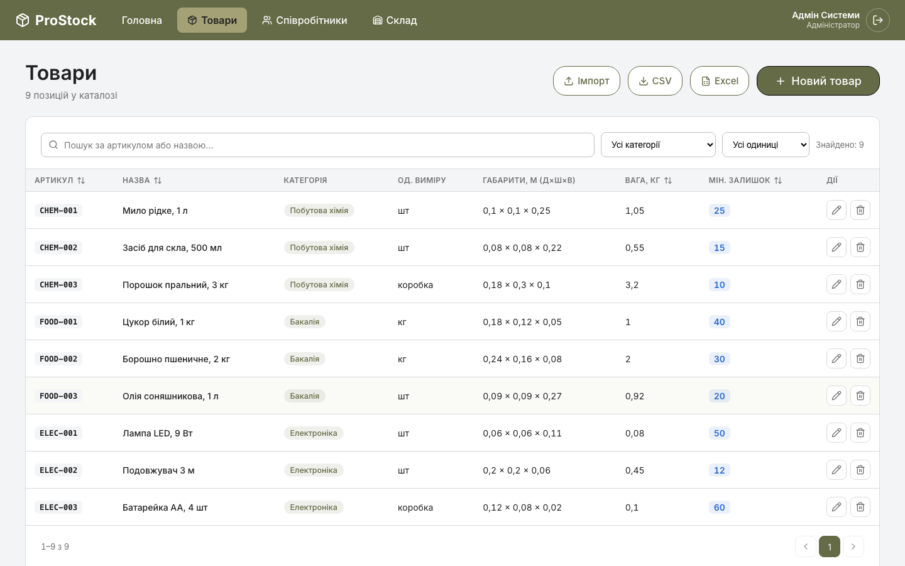

- заголовок із кількістю позицій (правильні відмінки: 1 позиція / 2 позиції / 5 позицій);
- дії: Імпорт, експорт CSV, експорт Excel, «Новий товар» (залежно від ролі);
- пошук із debounce 350 мс, фільтри за категорією та одиницею виміру, скидання;
- таблиця: артикул, назва, категорія, одиниця, габарити, вага, мін. залишок, дії;
- сортування за артикулом/назвою/вагою/залишком, пагінація;
- стани: завантаження, помилка з повторенням, порожній каталог, «нічого не знайдено».

### Створення / редагування товару

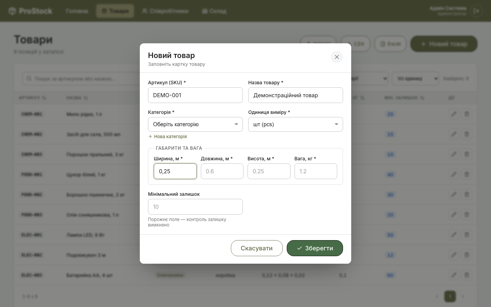

- модальне вікно з фокус-пасткою, закриттям по Esc і кліку по фону;
- поля з валідацією: SKU (унікальність, заборонені символи), назва, категорія,
  одиниця виміру, додатні габарити й вага, невід'ємний мін. залишок;
- створення категорії inline без виходу з форми;
- серверні `409`/`422` підсвічують конкретні поля;
- підказки під полями, блокування submit під час збереження.

### Імпорт і звіт про помилки

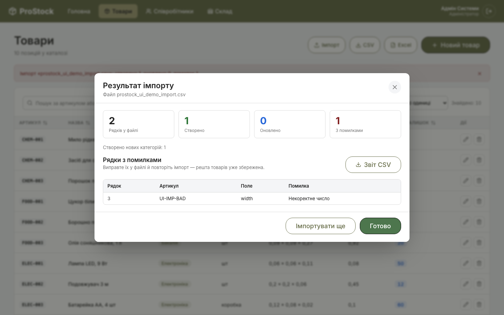

- drag&drop або вибір файлу, перевірка розширення та розміру (5 МБ) на клієнті;
- підсумок: усього / створено / оновлено / з помилками / нові категорії;
- таблиця помилок: рядок, артикул, поле, причина; кнопка «Звіт CSV»;
- шаблони CSV/XLSX, пояснення правил імпорту;
- після завершення — банер у каталозі та автоматичне оновлення списку.

### Режим перегляду (RBAC)

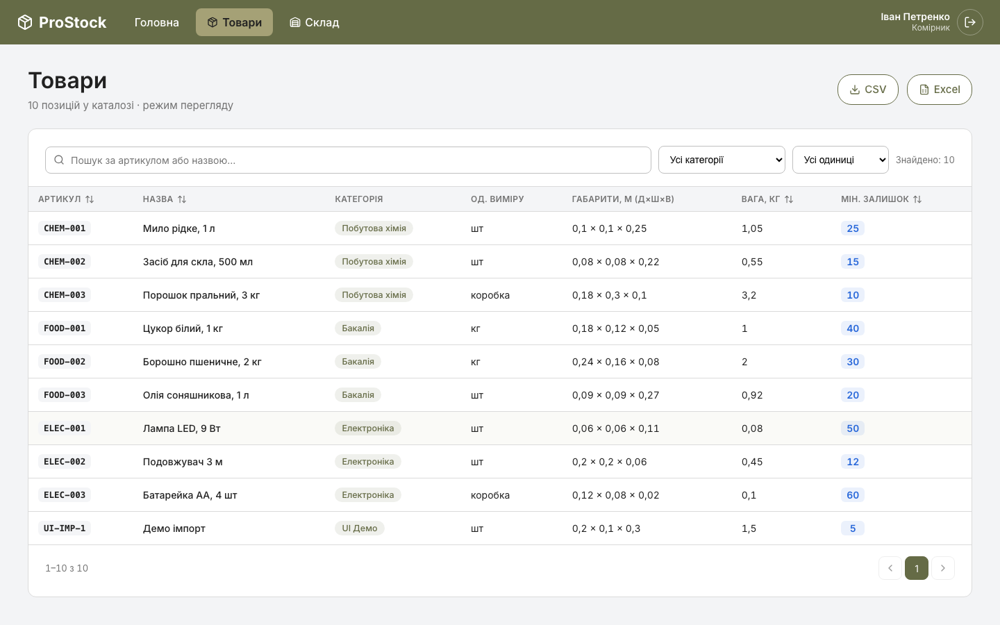

Комірник бачить каталог і експорт, але не бачить «Новий товар», «Імпорт» і кнопок
редагування/видалення. Прямий перехід на `/employees` показує екран «Недостатньо прав».

### Склад (карта)

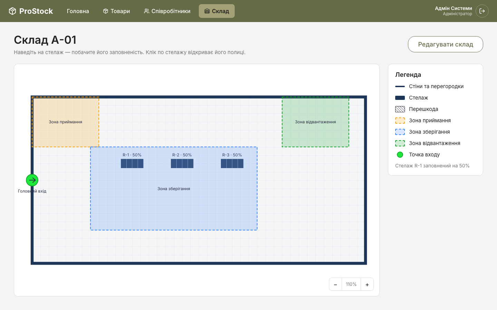

- 2D-карта з контуром приміщення, стелажами, зонами, перешкодами й точкою входу;
- підказка при наведенні, заповненість стелажа у легенді;
- клік по стелажу відкриває його полиці;
- порожній склад показує підказку «Натисніть Редагувати склад».

### Конструктор складу

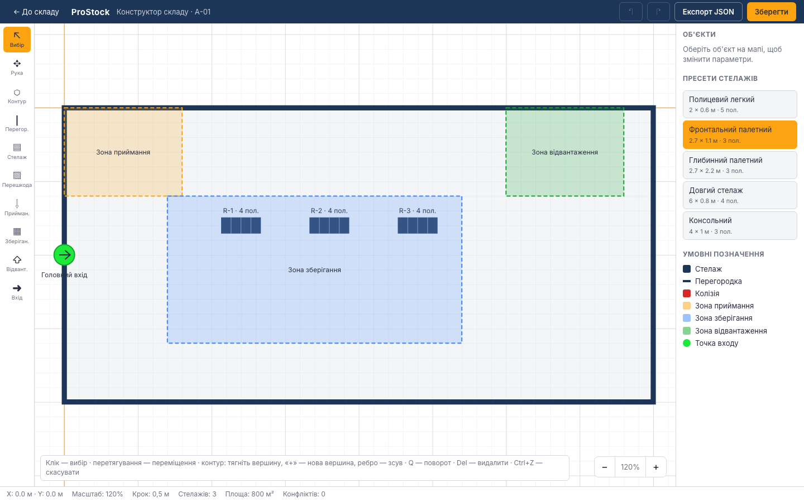

- інструменти: вибір, контур, перегородка, стелаж, перешкода, зони, вхід;
- сітка 0,5 м, масштабування, панорамування, гарячі клавіші;
- збереження в БД: топологія переживає перезапуск сервера;
- експорт JSON, undo/redo, підсвітка конфліктів.

### Стелаж

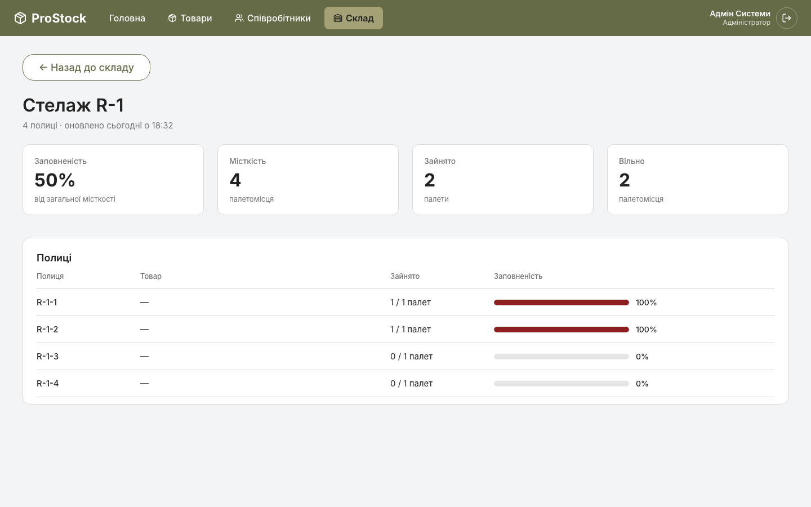

- KPI: заповненість, місткість, зайнято/вільно;
- таблиця полиць із прогрес-барами (критична заповненість — червона).

### Співробітники

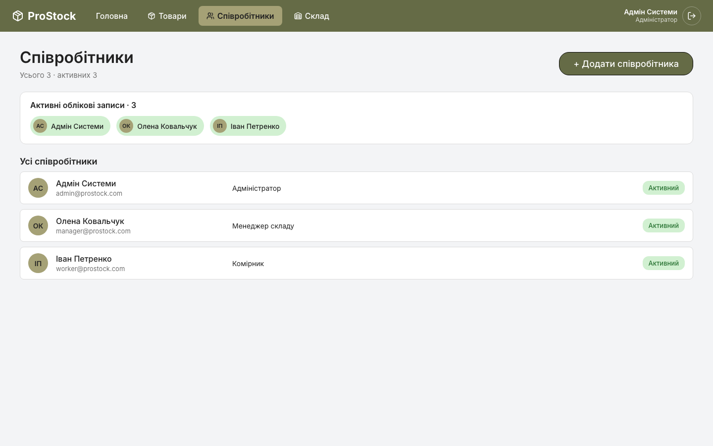

- активні облікові записи та повний список;
- роль, пошта, статус; доступ лише для root/адміністратора.

### Новий співробітник

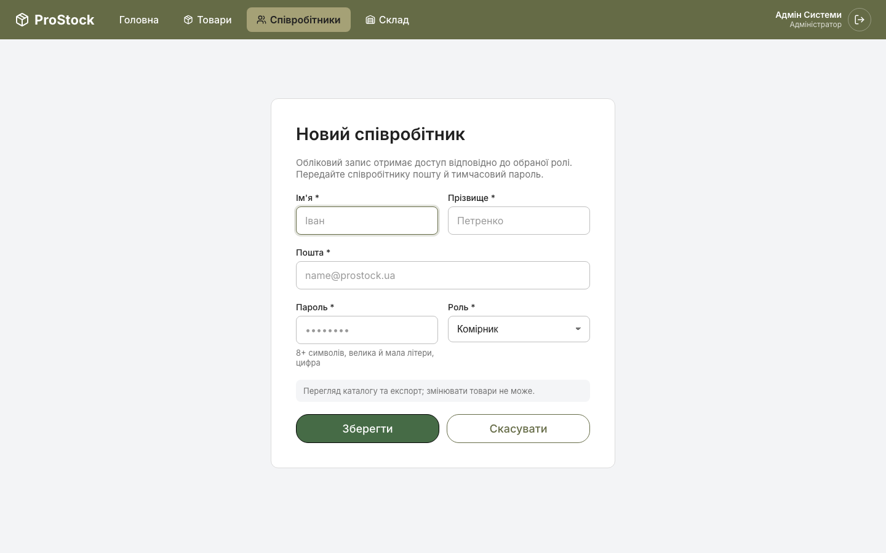

- ім'я, прізвище, пошта, пароль, роль;
- валідація пароля (8+, велика/мала літери, цифра) і пояснення прав ролі;
- серверні помилки (409 — зайнята пошта).

### Мобільна версія

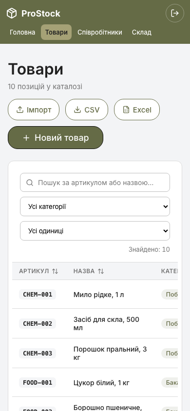

- навбар переносить вкладки на другий рядок;
- дії переносяться, кнопки не обрізаються;
- фільтри в один стовпець, таблиця прокручується горизонтально;
- модальні вікна відкриваються знизу на всю ширину.

## Доступність

- усі поля мають `<label>` + `aria-label`, помилки — `role="alert"` і `aria-invalid`;
- модальні вікна: `role="dialog"`, `aria-modal`, фокус-пастка, повернення фокуса;
- сортування таблиці: `aria-sort` (ascending/descending/none);
- статуси й банери: `role="status"`, помилки — `role="alert"`;
- контраст тексту відповідає WCAG AA для основної палітри;
- керування з клавіатури: Tab, Enter, Esc; видимий `:focus-visible`.

## Компоненти

`src/components`: `Modal`, `ConfirmDialog`, `ProductFormModal`, `ImportProductsModal`,
`Input`, `Select`, `Button`, `NavBar`, `AppLayout`, `ui` (PageHeader, Card, стани,
баджі, прогрес). Стилі — CSS Modules + токени; жодних inline-стилів, крім дрібних
службових (екран відмови в доступі).

## Відтворення скріншотів

```bash
# бекенд :8000, фронтенд :5173 (або :5174)
python3 -m pip install playwright && python3 -m playwright install chromium
# скрипт знімків — docs/capture_screens.py (див. репозиторій)
python3 docs/capture_screens.py
```
